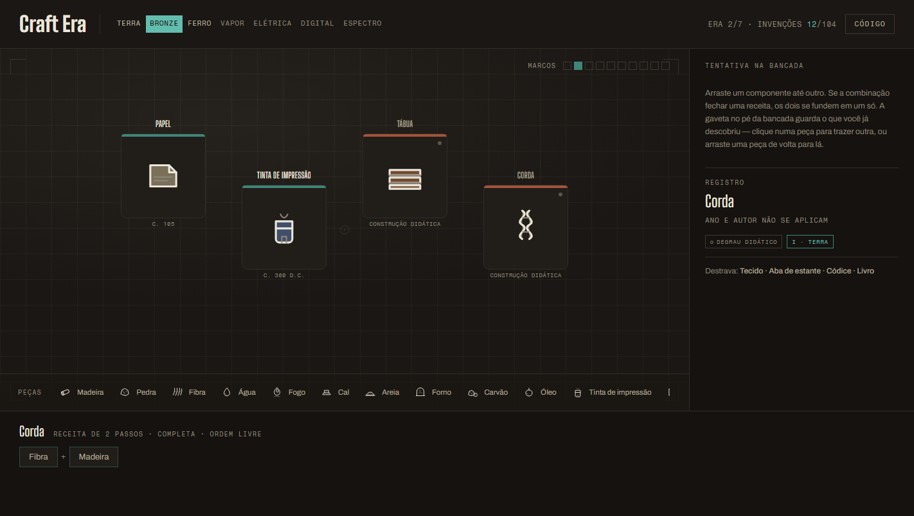

# Craft Era



Um jogo de combinação no formato *Infinite Craft* em que a árvore de receitas é a **genealogia
das invenções**: você arrasta componentes sobre a bancada e remonta, na ordem em que
aconteceram, os encadeamentos que construíram o mundo moderno — de quatro matérias-primas
até a inteligência artificial generativa.

A tese do jogo é que nenhuma invenção é um gênio isolado. O tear de Jacquard precedeu o
computador em dois séculos; a prensa de Gutenberg só existiu porque o papel e a tinta já
existiam; a IA generativa herdou duzentos anos de engenharia. O jogo força você a sentir isso
na mão: não dá para montar um smartphone sem antes ter resolvido o computador pessoal, a
internet, a tela sensível ao toque e a bateria de íon-lítio.

## Jogar

**No navegador:** <https://jhow-ds.github.io/craft-era/>

Ou sem servidor nenhum: **baixe o repositório e abra `index.html` com duplo clique.** Não há
build, não há dependências.

O jogo precisa de internet apenas para carregar as três fontes tipográficas (Big Shoulders
Display, Archivo e Fragment Mono). Offline ele continua funcionando, com as fontes do sistema.

## Como funciona

- **Arraste** uma peça sobre outra. Se a combinação fechar uma receita, as duas se fundem em
  uma invenção nova; se não fechar, elas apenas se afastam.
- **Receita de 2 ingredientes** funciona em qualquer ordem. **Receita de 3 ou 4** exige a
  ordem histórica de montagem, passo a passo.
- A **gaveta** no pé da bancada guarda tudo o que você já descobriu. Clique para trazer de
  volta, ou arraste uma peça para lá para devolvê-la.
- Cada invenção montada abre um **registro**: o ano, quem inventou, a era a que pertence e o
  que ela **destrava** na árvore.
- **Dez invenções centrais** — os marcos, de 3500 a.C. a 2022 — abrem uma ficha completa com o
  texto histórico. Os dez quadrados no alto da bancada são o seu placar.
- O progresso fica salvo no navegador. A navegação por teclado, os leitores de tela e as
  telas de 375 px funcionam.

## Fidelidade histórica

O padrão de rigor é **misto e declarado**, e isso é parte explícita do produto:

- Os **marcos** são invenções reais, datadas e atribuídas a quem as fez (Roda · c. 3500 a.C. ·
  Uruk, Suméria; Prensa tipográfica · c. 1450 · Johannes Gutenberg, Mainz).
- Os **materiais e etapas intermediárias** — 52 peças, metade do jogo — são degraus didáticos
  criados para costurar uma invenção na outra. Eles aparecem rotulados como
  `CONSTRUÇÃO DIDÁTICA` na própria interface, e o registro escreve "ano e autor não se aplicam".
- O jogo nunca apresenta uma simplificação como se fosse fato histórico.

## O que tem dentro

| | |
|---|---|
| Peças | 104 |
| Receitas | 100 (6 delas de ordem obrigatória) |
| Eras | 7, com identidade cromática própria |
| Marcos | 10 invenções centrais, datadas e atribuídas |
| Caminho mais longo | 17 combinações, das matérias-primas à IA generativa |
| Matérias-primas | Madeira, Pedra, Fibra, Água |

A arte é o ponto de partida visual do projeto: **104 ícones desenhados como SVG escrito à mão**
dentro do próprio arquivo, todos na mesma linguagem de traço — contorno de dois tons, pontas
arredondadas, `viewBox` 72×72. Nada de imagem externa, nada de emoji, nada de dependência de
assets. Cada invenção é desenhada como o artefato material que ela é.

## Caderno de receitas (PDF)

**[`Craft-Era-receitas.pdf`](Craft-Era-receitas.pdf)** — as 100 receitas, era por era, com a
ordem exata de cada montagem e o custo em combinações, mais um índice alfabético com caixas
para marcar o que a turma já montou. É o documento do professor, para quando alguém travar em
uma receita. Uma página de capa explica a leitura; não distribua antes da hora, ele contém a
solução de tudo.

## Estrutura

```
index.html                  o jogo inteiro: HTML, CSS, JavaScript e os 104 SVG
PRODUCT.md                  verdade do produto: usuários, contexto, restrições
DESIGN.md                   sistema visual: tokens, escala tipográfica, componentes, recusas
Craft-Era-receitas.pdf      caderno de receitas do professor
docs/craft-era.png          captura usada neste README
```

`PRODUCT.md` e `DESIGN.md` são os dois documentos que governam o projeto: o que o produto
promete e como ele se parece. Vale ler antes de mexer em qualquer coisa.

## Decisões que parecem omissões

- **Não há áudio.** É deliberado: a bancada é um lugar de leitura e concentração, e o jogo
  precisa funcionar em sala de aula com trinta pessoas na mesma sala.
- **Não há imagens de terceiros nem build.** Um arquivo, aberto por duplo clique, é o formato
  do produto.

## Licença

MIT. Veja [LICENSE](LICENSE).

Fontes: [Big Shoulders Display](https://fonts.google.com/specimen/Big+Shoulders+Display),
[Archivo](https://fonts.google.com/specimen/Archivo) e
[Fragment Mono](https://fonts.google.com/specimen/Fragment+Mono), do Google Fonts (SIL Open
Font License).
